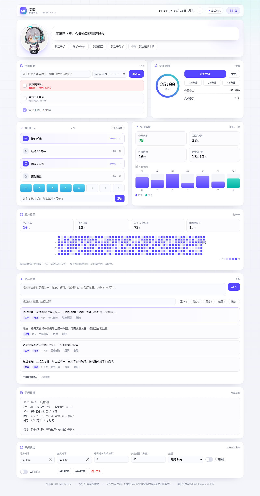

# CYBER NANNY · 赛博保姆

> 一个会盯着你干活的本地网页应用。打卡、任务、番茄钟、久坐提醒、积分惩罚、毒舌点评，全在一个 HTML 文件里。

**在线试用** → <https://minj65446-ops.github.io/cyber-nanny/> ｜ 想看满数据的样子，加 `?demo=1`




---

## 她是谁

**诺诺（Nono）**，赛博女仆型监工。银灰短发、青色呆毛、机械耳、左眼一片 HUD 面罩。她会盯着你的任务列表，记住你几点起床，也会在你摸鱼的时候当场扣分。

四张表情差分，随时切换：

| 待机 | 满意 | 训话 | 犯困 |
|---|---|---|---|
|  |  |  |  |

表情不是装饰——它跟事件走：夸你时笑、逾期时黑脸、23 点后自动犯困。

## 会做什么

| 模块 | 说明 |
|---|---|
| 每日打卡 | 起床 / 运动 20 分钟 / 阅读 / 睡觉，四项独立计分 |
| 喝水 | 8 杯可点，逐杯加 3 分，目标数可改（最多 16） |
| 任务清单 | 支持截止时间，逾期变红并扣 12 分，逾期补完只算半分 |
| 番茄钟 | 15 / 25 / 45 分钟，环形进度，完成加 10 分并提示起身 |
| 久坐提醒 | 默认 45 分钟，超时提示音 + 台词，可调 10–180 分钟 |
| 积分体系 | 正负都记，负数时顶栏变红 |
| 四档人格 | 毒舌总管 / 温柔姐姐 / 冷面机械 / 军训教官，各一套台词库 |
| 语音播报 | 开关在「保姆设定」，走浏览器 TTS |
| 保姆日报 | 自动生成五段式总结，一键复制发群里交代 |
| 周趋势 | 近 7 日积分柱状图，今天高亮 |
| 数据 | 只存 localStorage，跨天自动归档，可导出 JSON |

## 快速开始

没有构建，没有依赖，没有后端。

```bash
git clone https://github.com/minj65446-ops/cyber-nanny.git
cd cyber-nanny
```

双击 `index.html`，或者：

```bash
python -m http.server 8080   # 然后访问 http://localhost:8080
```

想直接看满数据的界面：打开 `index.html?demo=1`（演示数据不写盘）。

## 换掉她的脸

`assets/` 里四张图就是全部形象资源，替换成同名文件即可换成你自己的角色：

```
assets/
├── nanny-normal.webp   # 待机
├── nanny-happy.webp    # 满意 / 夸奖
├── nanny-angry.webp    # 训话 / 逾期
└── nanny-sleepy.webp   # 犯困 / 深夜
```

建议正方形、512×512 以上、人物居中偏上（头像按 `object-position: 50% 16%` 裁切）。
图片缺失时不会白屏，会自动回落到内置的 SVG 机器人头像。

## 常驻提醒（可选）

网页关掉就不再提醒。要真正到点催人，用这个零依赖脚本：

```bash
python nanny_reminder.py
```

- 定点提醒改顶部 `SCHEDULE`，久坐间隔改 `SIT_EVERY_MIN`，`VOICE = False` 关语音
- 弹窗置顶 + 提示音 + Windows SAPI 朗读，记录写入 `nanny_log.txt`
- 需要带 tkinter 的 Python（Windows 官方安装包默认自带）
- 要开机自启：`Win+R` → `shell:startup`，放一个 `.bat` 进去

## 人格提示词

`PERSONA.md` 是一份可直接粘贴的监督人格设定，输出强制为「判定 / 评价 / 下一步动作」三段式。不装这个网页，光用提示词也能让任意 AI 变成赛博保姆。

## 数据与隐私

- 所有数据在浏览器 localStorage，key `cyberNanny.v1`，不上传任何地方
- 没有统计、没有埋点、没有第三方请求
- 「保姆设定 → 导出数据」拿到 JSON 备份，「清空重来」彻底删除

## 目录结构

```
cyber-nanny/
├── index.html            # 主应用（单文件，含全部 CSS/JS）
├── assets/               # 四张表情差分
├── docs/screenshot.png   # 截图
├── nanny_reminder.py     # 常驻定时提醒脚本
├── PERSONA.md            # AI 人格提示词
└── README.md
```

## Roadmap

- [ ] 更长的历史视图（月视图 / 热力图）
- [ ] 任务分类与权重
- [ ] 多角色主题（换立绘即换人格）
- [ ] 移动端添加到主屏的 PWA manifest

欢迎提 issue 或 PR，尤其是新的台词——现在的毒舌还不够狠。

## 授权

代码 MIT。`assets/` 内的角色立绘为 AI 生成，随项目一同以 MIT 分发；如需商用请自行确认所在司法辖区的 AI 生成内容规定。

---

**English**: Cyber Nanny is a single-file, offline HTML app that nags you into finishing your day — habit check-ins, tasks with deadlines, a pomodoro timer, sit-still reminders, a points system with penalties, four nanny personas, and an anime mascot whose expression follows your behavior. No build step, no backend, data stays in `localStorage`.
