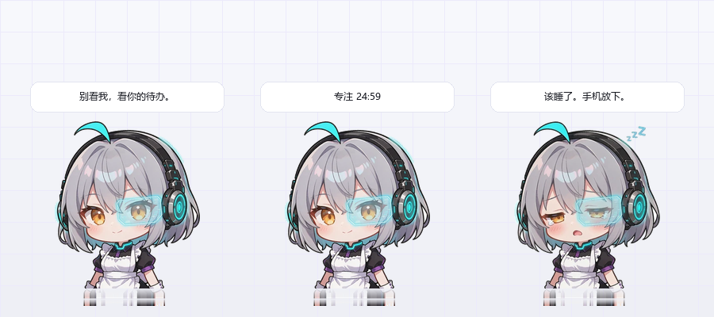
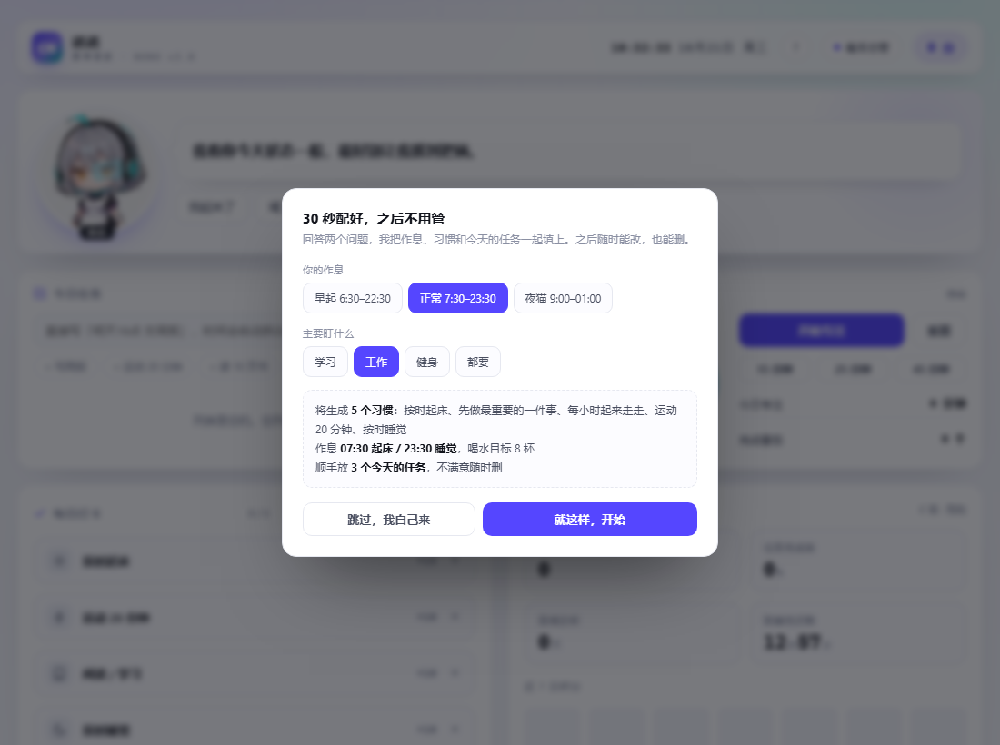
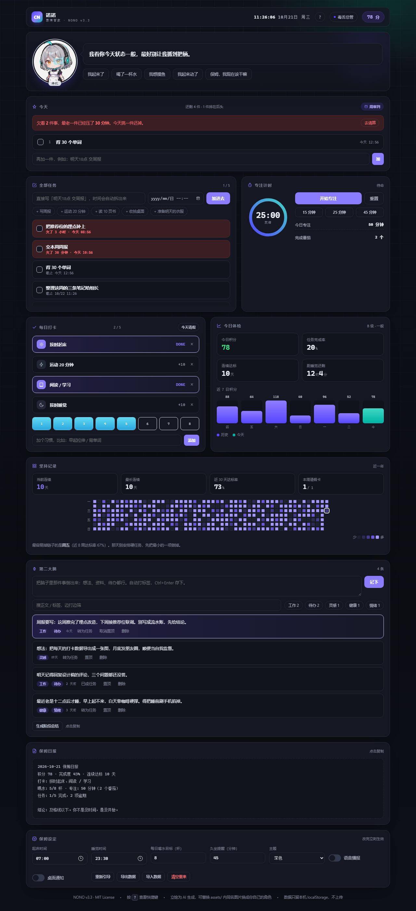
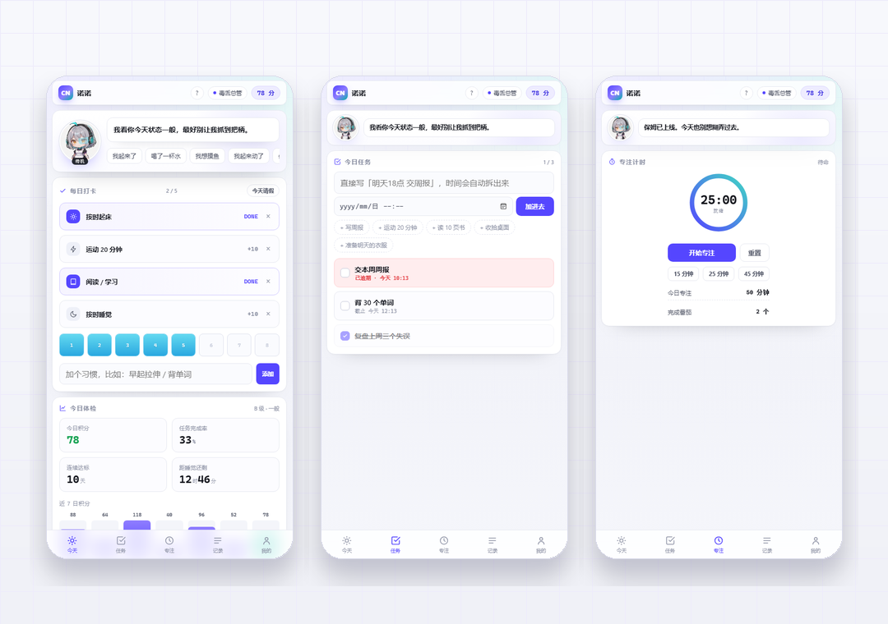

# 诺诺 · 赛博管家

> 一只住在桌面上的赛博女仆。会盯着你干活，会催你喝水，会在你熬夜的时候黑脸。
> 桌面宠物 + 本地面板，全部离线，数据不出本机。

**在线面板** → <https://minj65446-ops.github.io/cyber-nanny/> ｜ 想看满数据的样子，加 `?demo=1`




---

## 两种形态

| 形态 | 是什么 | 从哪进 |
|---|---|---|
| **桌宠** | 常驻桌面右下角的透明小人，可拖动、会说话、能打卡、能计时、到点提醒 | `nanny_pet.py` |
| **面板** | 打卡 / 任务 / 番茄 / 第二大脑 / 年度热力图 / 日报 | `index.html`，或双击桌宠打开 |
| **手机** | 同一份页面，装到主屏就是 App：底部五个 Tab，单列大按钮 | 浏览器打开线上地址 → 添加到主屏幕 |

桌宠负责"在场感"和随手打卡，面板负责"记账"和长期统计。两边数据各自独立：桌宠记位置、人格、当日打卡与番茄数；面板记任务、笔记和全部历史，互不打扰。

## 她是谁

**诺诺（Nono）**，赛博女仆型监工。银灰短发、青色呆毛、机械耳、左眼一片 HUD 面罩。

四张表情差分，跟事件走：夸你时笑、逾期时黑脸、23 点后自动犯困。

| 待机 | 满意 | 训话 | 犯困 |
|---|---|---|---|
|  |  |  |  |

## 桌宠：跑起来

需要 **Python 3.9+**（要带 tkinter，Windows 官方安装包默认带）和 Pillow：

```bash
git clone https://github.com/minj65446-ops/cyber-nanny.git
cd cyber-nanny
pip install pillow
python nanny_pet.py
```

不想看黑框，双击 `start-pet.bat`（自动找 `pythonw`，找不到会提示装 Python）。

### 怎么跟她相处

| 操作 | 效果 |
|---|---|
| 拖动 | 挪位置，松手后记住，重启还在原地 |
| 单击 | 换一句台词 |
| 双击 | 打开网页面板 |
| 右键 | 菜单：专注 / 人格 / 大小 / 置顶 / 安静 / 开机自启 / 退出 |
| 滚轮 | 缩放（0.65×–1.5×） |

### 右键菜单

- **今日打卡** 起床 / 运动 / 阅读 / 睡觉，点一下就打勾；喝水 +1。不用开面板，气泡里直接显示「打卡 3/5」
- **开始专注** 15 / 25 / 45 分钟，气泡里显示倒计时，结束响一声并夸你一句
- **人格** 毒舌总管 / 温柔姐姐 / 冷面机械 / 军训教官，各一套台词
- **总在最前** 关闭后会退到其他窗口后面
- **安静模式** 只保留定点提醒，不再随机唠叨
- **开机自启** 写 HKCU 的 Run 项，用 `pythonw` 启动，不弹控制台
- **回到右下角** 把她拽丢了就用这个

### 找不到她了？

再运行一次 `nanny_pet.py`：第二个实例不会重复启动，而是让她自己跑回右下角并说一句"我在这儿"。

### 改提醒时间

`nanny_pet.py` 顶部的 `SCHEDULE`：

```python
SCHEDULE = [
    ("07:00", "wake"),
    ("10:00", "water"),
    ("12:30", "water"),
    ("14:30", "nag"),
    ("16:30", "water"),
    ("19:00", "nag"),
    ("22:30", "sleep"),
]
```

左边是时间，右边是台词类别（`wake` / `water` / `nag` / `sleep`）。

### 桌宠的配置在哪

`%APPDATA%\cyber-nanny\pet.json`（位置、大小、人格、番茄数）与 `pet.log`（崩了会写在这里）。
删掉 `pet.json` 就回到默认状态。

## 第一次打开：30 秒配好

不用从空白开始。首次进入会问两个问题——作息（早起 / 正常 / 夜猫）和主要盯什么（学习 / 工作 / 健身 / 都要），然后自动生成：

- 5 个对应的习惯（学习：专注 2 小时、背 30 个单词…；健身：运动 40 分钟、走够 8000 步…）
- 起床 / 睡觉时间、8 杯水的目标
- 3 个今天就能做的任务

不满意可以点「跳过，我自己来」，之后在设置里「重新引导」也能重来。



## 面板：网页版

一个 HTML 文件，双击就能开，也能装成 PWA 离线用。

### 任务不用挑日期

直接在输入框里写一句话，时间会自己拆出来：

| 你写的 | 拆成 |
|---|---|
| `明天18点 交周报` | 交周报 · 明天 18:00 |
| `30分钟后 泡咖啡` | 泡咖啡 · 30 分钟后 |
| `周五9点 开会` | 开会 · 本周五 09:00 |
| `晚上8点 健身` | 健身 · 今晚 20:00（过了就顺延到明天） |
| `后天 体检` | 体检 · 后天 09:00 |

带时间的写法都能识别，剩下的就是标题。手动在日期框里选了时间，则以手动为准。

下面还排了一行常用任务（写周报 / 运动 20 分钟 / 读 10 页书…），点一下直接进列表，一个字都不用打。


| 模块 | 说明 |
|---|---|
| 每日打卡 | 默认起床 / 运动 / 阅读 / 睡觉，可增删自定义习惯 |
| 喝水 | 8 杯可点，目标可改（最多 16） |
| 任务清单 | 支持截止时间，逾期变红并扣 12 分，逾期的自动顶到最前 |
| 番茄钟 | 15 / 25 / 45 分钟 + 工作-休息循环，进度跨刷新可恢复 |
| 久坐提醒 | 默认 45 分钟，提示音 + 台词 |
| 积分体系 | 正负都记，负数顶栏变红，撤销完成按实得分回退 |
| 断链保护 | 每天可请一次假：不加分但连续不断，每周一张 |
| 年度热力图 | 52 周 × 7 天，四档色阶，配当前/最长连续、30 天达标率 |
| 薄弱日分析 | 统计近 8 周各星期达标率，点名你最容易掉链子的那天 |
| 第二大脑 | 随手记 + 自动打标签 + 检索 + 一键转任务 + 阶段总结 |
| 深色模式 | 跟随系统 / 浅色 / 深色，首帧前生效不闪白 |
| PWA | 可安装、断网可用；有更新会提示刷新 |
| 数据 | localStorage，跨天归档，可导出 / 导入 JSON |

快捷键：`N` 记笔记、`/` 搜索、`P` 番茄、`W` 喝水、`T` 任务、`D` 主题、`?` 帮助。

深色模式：



## 手机上用

桌上的那只是 Windows 专属，手机上是同一份面板，改成了底部 Tab 的单列布局：



| Tab | 里面有什么 |
|---|---|
| 今天 | 打卡、喝水、今日体检（积分 / 完成率 / 连续 / 距睡觉） |
| 任务 | 一句话加任务、常用任务、清单 |
| 专注 | 番茄钟、今日专注与番茄数 |
| 记录 | 第二大脑：随手记、检索、转任务 |
| 我的 | 坚持记录（热力图）、日报、设定、导出 |

**装到主屏**（不需要应用商店）：

- iPhone / iPad：Safari 打开线上地址 → 分享 → 「添加到主屏幕」
- Android：Chrome / Edge 打开 → 菜单 → 「安装应用」或「添加到主屏幕」
- 装完是独立窗口，没有地址栏，断网也能开（Service Worker 缓存）

手机上会自动收窄：热力图只显示最近 16 周、人物缩成顶部一条、输入框字号 16px 防止 iOS 聚焦放大、删除按钮常驻可见。桌面宽度下仍是完整仪表盘。

> 想要微信小程序那种形态，得先有 AppID 并用微信开发者工具导入上传，代码可以另做一份，但和这个 PWA 是两套东西。

## 断链保护怎么算

连续天数只认"当天完成度 ≥ 60%"或"当天请假"。今天还没达标不算断链，从昨天往前数；一旦达标就把今天算进去。请假卡每周一张，跨天回满，出差或生病不会把攒了几周的链子清零。

## 换掉她的脸

桌宠用的是 `assets/pet/` 里的透明 PNG，面板用的是 `assets/` 里的原图：

```
assets/
├── nanny-normal.webp     # 面板用：待机
├── nanny-happy.webp      # 面板用：满意
├── nanny-angry.webp      # 面板用：训话
├── nanny-sleepy.webp     # 面板用：犯困
└── pet/
    ├── nono-normal.png   # 桌宠用：已抠图、底部渐隐
    ├── nono-happy.png
    ├── nono-angry.png
    └── nono-sleepy.png
```

换桌宠素材要注意三点：**透明底**、**人物居中**、**底部做 15–20px 渐隐**（不然贴到桌面上会像被切断）。尺寸比例接近 348×441 就行，程序会等比缩放。

`icon-*.png` 是安装图标，换角色后建议一并重做。缺图不会白屏，会显示一行提示。

## 常驻提醒（可选，更狠）

网页和桌宠都要求进程活着。要真正到点弹窗盖住一切，用这个零依赖脚本：

```bash
python nanny_reminder.py
```

弹窗置顶 + 提示音 + Windows SAPI 朗读，记录写进 `nanny_log.txt`。改顶部 `SCHEDULE` 调时间，`VOICE = False` 关语音。要开机自启：`Win+R` → `shell:startup`，放个 `.bat` 进去。

## 人格提示词

`PERSONA.md` 是一份可直接粘贴的监督人格设定，输出强制为「判定 / 评价 / 下一步动作」三段式。不装这个应用，光用提示词也能让任意 AI 变成同一个人。

## 数据与隐私

- 面板数据在浏览器 localStorage，key `cyberNanny.v1`，不上传
- 桌宠数据在 `%APPDATA%\cyber-nanny\`，只有位置、人格、番茄数
- 没有统计、没有埋点、没有第三方请求，字体图标全本地
- 复盘、导出、清空都在面板「保姆设定」里

## 目录结构

```
cyber-nanny/
├── nanny_pet.py            # 桌宠主程序（tkinter，无边框透明置顶）
├── start-pet.bat           # 双击启动桌宠（无控制台）
├── index.html              # 面板（单文件，含全部 CSS/JS）
├── manifest.webmanifest    # PWA 清单
├── sw.js                   # Service Worker
├── assets/                 # 立绘 + pet/ 透明素材 + 安装图标
├── docs/                   # 截图
├── nanny_reminder.py       # 常驻弹窗提醒脚本
├── PERSONA.md              # AI 人格提示词
├── CHANGELOG.md
└── README.md
```

## Roadmap

- [x] 桌宠形态（透明、置顶、拖动、菜单）
- [x] 番茄计时与定点提醒
- [x] 开机自启
- [x] 桌宠直接打卡（不用开面板）
- [x] 首次引导：30 秒生成习惯 / 作息 / 任务
- [x] 任务一句话建（自动拆截止时间）
- [x] 手机端底部 Tab 布局 + PWA 安装
- [ ] 系统托盘图标（关掉窗口还能从托盘叫回）
- [ ] 桌宠与面板数据互通（两边打卡合并统计）
- [ ] 多角色皮肤包

欢迎提 issue 或 PR，尤其是新的台词——现在的毒舌还不够狠。

## 授权

代码 MIT。`assets/` 内的角色立绘为 AI 生成，随项目以 MIT 分发；商用请自行确认所在司法辖区的 AI 生成内容规定。

更新记录见 [CHANGELOG.md](CHANGELOG.md)。

---

**English**: Nono is a desktop pet plus a local dashboard. The pet (`nanny_pet.py`) is a frameless, transparent, always-on-top tkinter window that sits in the corner of your screen — drag it, click it for a line, double-click to open the panel, right-click for pomodoro / persona / size / autostart. The panel (`index.html`) tracks habits, tasks, pomodoro, notes and a year-long consistency heatmap, with streak forgiveness, dark mode and PWA install. No build step, no backend, no telemetry — all data stays on your machine.
